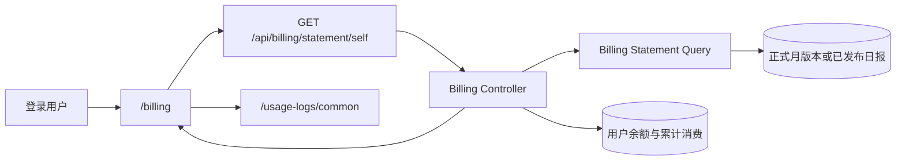

# API Key 用量账单架构

## 1. 目的与范围

本文描述用户用量账单如何以“周期 × API Key × 模型”为粒度汇总已经发生的结算事实，并与 Dashboard、钱包、用量日志和计费主链路保持解耦。

账单是用量与费用结算记录，不是税务发票或复式记账系统。本文不设计期初/期末余额、逐笔充值勾稽、跨期冲销或历史价格重算。

管理员客户账单与上游对账两个 Tab、上游月度折扣与审计，以及请求级计费快照的边界见
[客户与上游对账架构](账单计费-客户与上游对账架构.md)；两者共享前端 `billing-reconciliation` 模块与只读查询入口，
但不共享金额汇总对象。

## 2. 当前实现状态

当前代码已经实现：

- 登录用户页面 `/billing`；
- 当前页面使用 `GET /api/billing/statement/self`，按自然月展示 API Key → 客户模型汇总；
- 账单明细与全范围净额统计 `GET /api/billing/statement/self/logs`、`/logs/stat`；
- 自助接口 `GET /api/billing/self`；
- 使用构成接口 `GET /api/billing/self/breakdown`；
- 最长 31 天的账单周期；
- API Key × 模型的服务端汇总；
- 输入、输出、总 Token、请求数、RPM、TPM、耗时、流式比例；
- 消费、退款和有符号净费用（净退回保留负数展示）；
- 当前余额与累计消费；
- 缓存、长短 Context、动态计费和数据质量明细；
- 用量日志下钻；
- SQLite、MySQL/PostgreSQL 使用 GORM 聚合的实现，以及 ClickHouse SQL 兼容测试。

当前控制台的自然月账单使用正式月版本或[已发布日报](账单计费-报表日汇总架构.md)。旧自助接口
继续提供原结算日志直读合同。

## 3. 架构决策

### 3.1 独立账单面

账单使用独立功能模块：

```text
web/src/features/billing-reconciliation/
web/src/routes/_authenticated/billing/
controller/billing_statement.go
model/billing_statement.go
controller/billing_statement_breakdown.go
model/billing_statement_breakdown.go
```

旧 `web/src/features/billing/` 在确认无生产路由或其他调用后已移除。原 `GET /api/billing/self`
和 breakdown 后端合同仍保留作为兼容入口，本次不因前端无引用而删除对外 API。

它不并入 Dashboard、Wallet 或 Usage Logs：

- Dashboard 面向运行分析，账单面向周期结算；
- Wallet 面向余额与充值，不表达模型用量；
- Usage Logs 面向单次请求审计，账单面向聚合；
- 独立模块减少对上游文件的接线和未来合并冲突。

### 3.2 结算日志是账单事实

消费与退款日志保存已入账事实。旧自助接口直接聚合日志，当前控制台通过日报或正式月版本读取投影。
历史费用沿用入账时的事实，`quota_data` 服务于 Dashboard。

客户账单统一排除原生渠道测试的完整标记记录（消费类型、`token_id=0`、`token_name=模型测试`、
`content=模型测试`），因为测试计算 quota 但没有扣客户资金。真实游乐场同样可能使用 `token_id=0`，
必须保留；按 API Key 分组不能将这些调用重新解释为模型测试。原始日志与上游实际用量仍保留测试事实。
客户月账单下钻通过独立账单明细接口，使用稳定用户 ID 和显式密钥 ID；`token_id=0` 精确表示游乐场，
不能当作未筛选。计费方式、模型和自然月与汇总保持一致；明细统计按同一范围计算消费减退款净额。

```text
历史费用 = 请求当时已结算并写入日志的 quota
```

模型价格、分组倍率、表达式档位和附加费用只在单次用量日志详情中解释，不在账单汇总层重新执行。

## 4. 系统上下文



账单查询是只读投影。任何页面筛选、汇总或导出都不能回写日志、余额或结算状态。

## 5. 数据口径

### 5.1 聚合键

服务端按以下维度聚合：

```text
user_id + token_id + token_name + model_name
```

随后以 `token_id + model_name` 合并历史名称变化，并使用最新非空日志名称作为展示名。删除后的 API Key仍可按 ID和历史日志参与账单。

### 5.2 请求与异步结算

带有 `task_id` 的异步调整日志影响 Token 和费用，但不重复计算逻辑调用：

| 指标 | 是否包含任务调整行 |
| --- | --- |
| 请求数 | 否 |
| 平均响应耗时 | 否 |
| 流式请求数 | 否 |
| 输入/输出 Token | 是 |
| 消费额度 | 是，仅消费日志 |
| 退款额度 | 是，仅退款日志 |

因此请求数表示逻辑调用次数，Token 和费用表示查询周期内已经记录的结算结果。

### 5.3 费用公式

每个明细行：

```text
gross_quota  = 周期内消费类型日志 quota 之和
refund_quota = 周期内退款类型日志 quota 之和
net_quota    = gross_quota - refund_quota   （有符号）
```

消费和退款按各自日志 `created_at` 归属周期。跨期退款不会回写原消费周期；净额与折前净额保留符号，
退款独立行、跨账期退款与筛选明细不得把负数截为零，保证子行与父级口径一致。该符号只用于账单
展示已发生的净退回；单次扣减计算、余额写入与负扣费安全约束不变，余额不会因展示符号变负。

### 5.4 计费方式分类与单位

账单行的计费方式分类只读请求发生时冻结的事实，不读取当前模型价格、不按模型名或相邻行推断：

- 存在冻结表达式时，按表达式的实际 Token 计量依赖分类（优先于旧任务快照的 per-call 标记）；
  原生 `u()` 单位在创建时从已选定 adapter 冻结到 `BillingSnapshot.UsageUnits`，只引用已声明
  Token 计量加 enum/boolean 条件时归为 `token`；声明为 `second` 的单一计量归为 `per_second`（按时长计费）。
  历史表达式中的宿主保留探针 `param("_task.duration_seconds")` 同样具有明确的秒单位；
  不以任意客户字段名猜测单位。credit、混合单位、动态计量引用或缺失单位保持 `unknown`。
- 旧同步表达式消费的默认 `billing_unit=token` 可能缺少实际 Token 计价。常规分类为 `unknown` 时，
  若冻结的条件定价树能唯一定位已记录的命中档位、该档价格是数字常量，且按冻结倍率及历史换算精确
  核对到已入账扣款，则按次归类。附加费用、显式图片数量、冲突证据或核对失败保留原分类。
  该规则只补账单投影，不改写源日志和资金事实。
- 成功的旧定价异步图片按任务冻结的计价分支写入账单单位。历史完成记录中的固定单价 `-1` 表示
  未配置固定价，存在已记录的 Token 用量时按 `token` 分类。
- 固定单价为零但发生了非零资金流水的旧 per-call 标记不能证明按次收费：有可确认 Token 用量时保持
  `token`。退款行未保存表达式且分类未知时，只读批量查询主库原 Task 的冻结表达式与单位，
  必须同时匹配 user、app（提交 API Key）、token、channel、客户模型和 task ID；唯一匹配才补充分类。
  缺失或重复匹配保持 `unknown`，数据库查询失败则返回错误；不复制金额、价格或用量，不回写日志。
  跨账期退款仍按退款发生时间计入。正单价按次与显式免费按次不受影响。
- `unknown` 是如实的信息边界，不是金额缺失：这些行的已知金额继续参与聚合，不伪造按次用量，
  也不为清空 unknown 而改标单位。按时长行显示请求数与金额，不伪造 Token、计费次数或累计秒数；
  页面、CSV 和明细筛选均支持 `per_second`。证据不足的固定表达式与混合单位仍保持未知。
- 预扣等于实扣的零差额结算仍写一条金额为零的完成调整行（记录最终用量），不增加逻辑请求数。

单笔费用解释（用量日志与账单详情的逐项金额）只读取该笔冻结事实：已保存的归一计费用量、冻结
表达式、命中分支与冻结折扣；仅展开命中价格分支实际引用的变量，不把未引用的计量重复相加。字段
缺失、总量冲突或与该笔扣费对账不符时不输出明细，保留原金额并说明不可核实；不按当前价格、当前
折扣或重新求值表达式重算历史。Anthropic 语义的冻结用量保持原口径，不生成 OpenAI 图片口径费用行。
缓存计量区分“上游已报告 / 上游未报告 / 未记录”三种报告状态；价格表列出缓存单价不代表发生命中
或供应商优惠已验证。

### 5.5 运行指标

```text
total_tokens = prompt_tokens + completion_tokens
average_rpm  = requests / 周期分钟数
average_tpm  = total_tokens / 周期分钟数
stream_ratio = stream_requests / requests
```

平均耗时来自消费日志中的秒级 `use_time`。值为 0 的合法消费行仍参与平均，页面不得将该指标解释为毫秒精度。

### 5.6 用户累计消费投影与启动自动校正

`users.used_quota` 是用户累计净消费（已入账预扣减已记录退款）的唯一投影，为 64 位 bigint 容量列；
单次收费的 int32 饱和规则不适用于该累计列。首页、用户列表、搜索、详情和 `/api/user/self` 共享
统一查询投影 `UserUsedQuotaForDisplay`，金额每次读取主库用户行，正常用户保持数值型 `used_quota`。

单实例、主库与日志同库的部署在新版本开放业务前自动执行历史校正（政策 `recorded-refunds-v1`）：
按精确总额边界判定——当前累计已等于留存消费减退款合计的保持不变；等于"消费减精确匹配已交付退款"
且无既有维护操作的修正为留存净额（含带标记的人工退款记录）；存在残差、负金额、重复 Request ID、
待交付事件或证据矛盾的阻断并标记不可用。校正逐用户提交、同事务写审计（before/delta/after 与证据
摘要），崩溃后续跑且重复启动不二次回减；审计留存用于防重复修复，不作为普通历史日志清理。

无法证明正确的用户返回 `used_quota: null`，界面统一显示「用量待核对」，不显示 0，也不继续把旧
虚高值当已核实值；余额等正常功能不受影响。主库与日志分库或 ClickHouse 拓扑不执行校正，累计展示
保持不可用。生产部署验收未完成前不宣称线上累计金额已修复（路线图跟进）。

## 6. 旧自助接口合同

```text
GET /api/billing/self
GET /api/billing/self/breakdown
UserAuth()
```

请求参数：

| 参数 | 约束 |
| --- | --- |
| `start_timestamp` | 必填，Unix 秒 |
| `end_timestamp` | 必填，Unix 秒 |
| 周期 | 大于 0 且不超过 31 天 |
| `token_id` | 可选，必须大于 0 |
| `model_name` | 可选，最长 255 字符 |

Controller 只使用认证上下文中的用户 ID，不接受任意 `user_id`。响应包含：

- `period`：实际查询周期；
- `funds`：当前余额和累计消费；
- `summary`：全周期汇总；
- `items`：API Key × 模型明细；
- `generated_at`：数据生成时间；
- `data_source=settlement_logs`。

额度字段返回原始 quota，由前端按当前站点货币和倍率配置格式化。

在这组旧自助接口内，`/api/billing/self` 提供金额与基础 Token；`/api/billing/self/breakdown` 只提供缓存、Context、动态计费和数据质量等可选解释。breakdown 中 `data_quality.unavailable_requests > 0` 表示历史元数据无法可靠解析，前端不得将其显示为零用量。

## 7. 前端职责

当前 `/billing` 以北京时间自然月查询 `/api/billing/statement/self`。未确认账期使用发布日
版本集合，明细与异步导出沿用该集合。已确认账期通过月状态、版本明细和文件入口读取正式版本。
账单按 API Key 与客户模型下钻，费用明细可展开逐笔入账事件。当前余额独立读取用户数据。
查询、筛选与展示均保留用户身份和服务端金额口径。具体交互见
[客户与上游对账架构](账单计费-客户与上游对账架构.md#8-前端边界)。

价格展示投影与单笔解释展示遵循统一规则：明确的 `image-generation` 入口且图片输入独立计价时，
基础输入单价显示“文字输入”，其余为图片输入、图片输出、文本缓存输入、图片缓存输入；通用入口
保留通用名称，不按模型名或价格数值推断模态。价格表保留冻结表达式投影的全部缓存价格（含显式
零价），不因本笔用量为零而隐藏。图片模型卡片、列表、详情、分档表与分组单价保留两位小数；小于
$0.01 的正价显示 `<$0.01`，并在卡片、列表与结构化价格表提供折扣前 USD/百万原始单价提示；一般
模型与非图片定价精度不变，账单分项金额保持解释费用所需精度，不截断为零。日志详情的费用算式把
金额作为完整单元展示，不在数字内部断行。管理员显式保存的价格与表达式优先于内置默认投影；历史
账单金额只来自冻结事实，改价后保持不变。

## 8. 旧自助接口的一致性、保留与失败边界

- 账单读取已写入日志的最终事实，不提供读写事务快照或月结封账。
- `LogConsumeEnabled` 关闭或日志被清理后，历史账单可能不完整。
- 账单生成时间不表示所有异步任务均已终态；后续结算会按日志发生时间进入后续查询结果。
- 当前余额和累计消费来自用户主数据，与周期日志不是严格的会计勾稽关系。
- 查询失败只影响账单页面，不得影响模型调用、结算或钱包。
- statement 可用但 breakdown 失败、不一致或元数据损坏时，正式金额继续展示，使用构成标为不可用且不进入顶部构成汇总。
- 前端缓存只用于短时读取性能，不能作为导出或审计的唯一数据源。

## 9. 数据库兼容

聚合查询使用 GORM 和三种主日志数据库均支持的能力：

- `CASE WHEN`；
- `COALESCE`；
- `SUM`、`AVG`、`MAX`；
- `LIKE` / `NOT LIKE`；
- `GROUP BY`。

禁止为账单引入单数据库 JSON 操作符。当前通过日志 `other` 中是否包含 `"task_id"` 识别异步调整行；如果未来改为结构化列，必须提供 SQLite、MySQL 和 PostgreSQL 一致迁移与回退。

ClickHouse 日志库使用同一口径，并由独立合同测试验证生成 SQL 的兼容性。

## 10. 权限与隐私

- 页面和接口只对已登录用户开放。
- 用户只能查看自己的账单。
- API Key只展示 ID和日志中的名称，不返回密钥值。
- 账单不返回请求体、prompt、上游响应、渠道或管理员信息。
- CSV 导出将当前页面筛选冻结为服务端异步任务，浏览器按文件列表直接下载私有存储产物；保留原始 quota/比例列及可解释的计费组成，未知保持空白。任务预算、权限和交付边界见《账单计费-客户与上游对账架构》；导出文件由用户自行保护。

## 11. 架构不变量

1. 历史费用只读结算日志，不按当前价格重算。
2. 异步调整影响 Token 和费用，但不重复增加请求数；预扣等于实扣仍写一条零金额完成调整行。
3. 账单展示的净额与折前净额保留符号（负净额表示净退回）；单次扣减、余额写入与负扣费安全约束不变。
4. 计费方式分类只读冻结表达式与冻结单位；unknown 如实保留，不从模型名或当前配置推断。
5. 账单查询不修改计费、余额、日志或数据库结构。
6. 账单与单次用量日志通过下钻关联，不复制费用解释器。
7. 账单不是税务发票或账务级流水。
8. 所有聚合继续兼容支持的数据库。

## 12. 相关文档

- [客户与上游对账架构](账单计费-客户与上游对账架构.md)
- [API Key 用量账单使用指南](../30-engineering/API-Key用量账单使用指南.md)
- [01 计费与分组运维手册](../40-operations/01-计费与分组运维手册.md)
