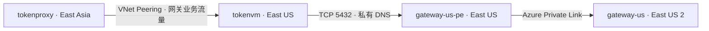

# Azure 网关环境与访问边界

本页描述 Azure 上的网关、代理和 PostgreSQL 环境，以及已验证的访问路径。配置和复验步骤见
[Azure 跨租户 PostgreSQL 私网配置手册](Azure跨租户PostgreSQL私网配置手册.md)。
本页以资源简称描述拓扑。实际订阅、资源组、资源 ID、地址、规格和主机名从授权的 Azure CLI 或 Portal 获取，
连接凭据从受保护的部署配置或秘密存储获取。

## 环境清单

| 资源 | 所属区域与职责 |
| --- | --- |
| `tokenvm` | East US 的 Linux VM，运行网关应用，是 PostgreSQL 私有端点的唯一获准网络来源。 |
| `tokenproxy` | East Asia 的 Linux VM，通过现有 VNet Peering 访问 `tokenvm` 上的网关服务。 |
| `gateway-us` | East US 2 的 Azure Database for PostgreSQL Flexible Server，处于 `Ready`，PostgreSQL 主版本 `18`，General Purpose，区域内跨可用区 HA 为 `Healthy`。 |
| `gateway-us-pe` | 部署在 East US 的网关 VNet，跨区域指向 `gateway-us` 的 `postgresqlServer` 子资源。数据库侧仅此端点为 `Approved`。 |
| 私有 DNS | VM 订阅内的 `privatelink.postgres.database.azure.com` 通过 DNS Zone Group 管理 A 记录，通过 VNet Link 向网关 VNet 提供解析。网关 VNet 使用 Azure 默认 DNS。 |
| 端点访问控制 | 网关侧子网已启用 `NetworkSecurityGroupEnabled`，关联 NSG。规则以网关 VM 主 NIC 的私有 IPv4 为源，以端点 NIC 的私有 IPv4 为目标。 |

网关 VM 和代理 VM 的 VNet 在 VM 订阅中。PostgreSQL 位于另一订阅和 Entra 租户，
私有端点请求由 VM 订阅发起、数据库订阅批准。VM 订阅已注册 `Microsoft.Network` 与 `Microsoft.DBforPostgreSQL`，
数据库订阅也已注册这两个资源提供程序。数据库网络模式支持 Private Endpoint，委派子网为空。

数据库使用 Azure 托管加密密钥。当前认证方式为 PostgreSQL 密码认证，Entra 数据库认证为 `Disabled`。
备份已启用，异地冗余备份为 `Disabled`。订阅实际的资源规格、备份保留期和加密状态以管理面查询为准。
区域内 HA 与跨区备份属于不同配置项。

## 数据路径与访问不变量



- 公网访问为 `Disabled`。数据库经唯一获批准的私有端点提供连接。
- 端点 NSG 先放行 `tokenvm` 主 NIC 的私有 IP 到端点 TCP `5432`，再拒绝其它到端点 IP 的入站连接。
  源地址规则隔离到 VM。该 VM 上的进程建立连接后，仍需通过 PostgreSQL 认证和数据库权限校验。
- 网关使用 Azure 返回的数据库原始 FQDN。网关环境中的私有 DNS 将其解析到端点 NIC 地址。
  TLS 校验使用同一 FQDN。直接填写端点 IP 会改变客户端用于证书主机名校验的输入。
- 网关与代理 VNet 两侧 Peering 都为 `Connected`。代理访问网关业务端口的路径继续使用该对等连接。
  端点 NSG 的拒绝规则只匹配端点目标地址，其他子网流量继续由原有 NIC NSG 决策。
- 网关主 NIC 的地址分配方式为 `Dynamic`。若 Azure 重新分配网关或端点的私有 IP，需同步核对 NSG 两端地址及
  私有 DNS 记录，再从网关和代理分别验证允许与拒绝。

## 数据库清单与业务接入状态

| SQL 数据库 | 用途与核对结果 |
| --- | --- |
| `postgres` | PostgreSQL 默认数据库，可以通过 TLS 认证登录和执行 SQL。核对时其中的非系统表和 `public` schema 表均为 `0`。 |
| `azure_sys`、`azure_maintenance` | Azure 托管系统数据库。 |

`gateway-us` 是 Flexible Server 资源名称。该资源下当前未发现独立业务数据库。当前验收范围是私网连通性、
认证、只读 SQL 和对等业务路径。数据库迁移、业务表导入、应用切库和备份恢复需按各自流程验收。
如果业务从 SQLite 迁入，先按 [SQLite 全量迁移 PostgreSQL 手册](SQLite全量迁移PostgreSQL手册.md)
准备专用数据库和演练环境，运行时连接按既有 `SQL_DSN` 注入。

## 已验证结果

以下是环境验收记录，复验时以当次实际结果为准。延迟样本来自网关 VM 和数据库的私网路径。

| 验证点 | 结果 |
| --- | --- |
| 网关 VM 到 PostgreSQL | 域名解析到端点私有 IP，TCP `5432` 可达，TLS 1.3 与主机名、证书链校验通过，认证后 `SELECT 1` 返回 `1`。 |
| 代理 VM 到 PostgreSQL | 两次连接端点 TCP `5432` 均超时。使用端点 IP 做负向测试，结果独立于 DNS。 |
| 代理到网关的业务路径 | 子网规则变更期间 `24` 次 `GET /api/status` 均返回 HTTP `200`，变更后复验返回 `200`。两侧 Peering 均为 `Connected`。 |
| TCP 建连延迟 | `20` 次采样，中位数 `6.78 ms`，P95 `12.17 ms`。 |
| 从开始建连到完成 PostgreSQL TLS 握手 | `20` 次采样，中位数 `36.93 ms`，P95 `43.36 ms`。 |
| 已认证连接上重复执行 `SELECT 1` | 复用一个连接，`12` 次采样，中位数 `5.81 ms`，P95 `6.01 ms`。 |

从 Mac 开 Docker 客户端仍使用本机网络。已观察到本机的隧道 DNS 返回保留网段地址，连接在认证前超时；
排查时应登录网关 VM 或进入应用的实际运行环境。临时客户端容器的系统证书库与 VM 可能不同，
本环境以 VM 上已验证的 CA 文件配合 `sslmode=verify-full` 完成 SQL 验收。

## Azure 只读复核入口

在管理员终端按[配置手册的资源核对步骤](Azure跨租户PostgreSQL私网配置手册.md#1-管理终端准备与资源核对)
填写变量。日常定位先读控制面，再从相关 VM 做最小范围的业务和 SQL 验证。使用查询字段过滤输出，避免收集完整资源配置。

```bash
az postgres flexible-server show --subscription "$DB_SUB" -g "$DB_RG" -n "$DB_SERVER" \
  --query '{state:state,region:location,version:version,sku:sku.name,storageGiB:storage.storageSizeGb,public:network.publicNetworkAccess,ha:highAvailability,backup:backup,encryption:dataEncryption.type}' \
  -o json
az postgres flexible-server db list --subscription "$DB_SUB" -g "$DB_RG" -s "$DB_SERVER" \
  --query '[].name' -o tsv
az postgres flexible-server private-endpoint-connection list --subscription "$DB_SUB" \
  -g "$DB_RG" -s "$DB_SERVER" \
  --query '[].{status:privateLinkServiceConnectionState.status,endpoint:privateEndpoint.id}' -o table
az network vnet peering list --subscription "$VM_SUB" -g "$NET_RG" --vnet-name "$VM_VNET" \
  --query '[].{name:name,state:peeringState,access:allowVirtualNetworkAccess}' -o table
az network vnet subnet show --subscription "$VM_SUB" -g "$NET_RG" \
  --vnet-name "$VM_VNET" -n "$VM_SUBNET" \
  --query '{nsg:networkSecurityGroup.id,policy:privateEndpointNetworkPolicies,route:routeTable.id}' -o json
az network nsg show --subscription "$VM_SUB" -g "$NET_RG" -n "$NSG_NAME" \
  --query 'securityRules[].{priority:priority,direction:direction,action:access,from:sourceAddressPrefix,to:destinationAddressPrefix,port:destinationPortRange}' \
  -o table
```
